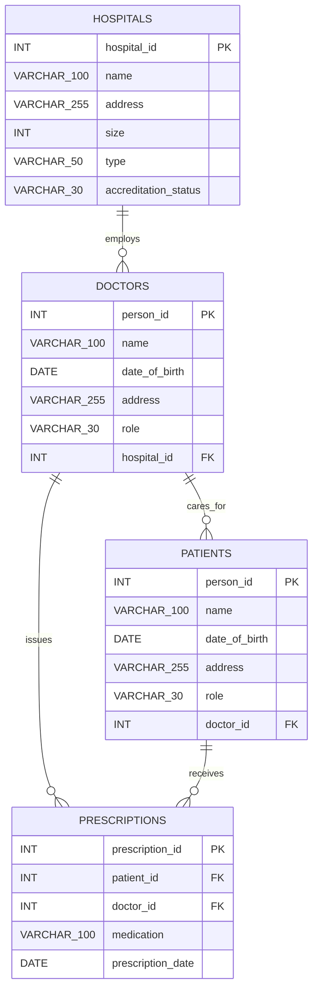

# Hospital Database — Entity Relationship Diagram

## Overview

This relational database models four interconnected healthcare entities:
hospitals, doctors, patients, and prescriptions.

The design uses primary keys to uniquely identify individual records
and foreign keys to maintain referential integrity across tables.

The database is implemented in MySQL 8.0 using the InnoDB storage engine.

## Entity Relationship Diagram

**Notation:** Data type labels such as `VARCHAR_100` and
`VARCHAR_255` represent SQL types `VARCHAR(100)` and
`VARCHAR(255)`, respectively. Underscores are used for
compatibility with Mermaid ERD notation.

`PK` denotes a primary key, while `FK` denotes a foreign key.

The crow's-foot notation `||--o{` represents a one-to-zero-or-many
relationship. Each record on the many side must reference exactly
one corresponding record on the one side.

## Entity Descriptions

### 1. Hospitals

Stores hospital identifiers, names, addresses, bed capacities,
hospital types, and accreditation statuses.

- Primary key: `hospital_id`
- Hospital capacity is represented by `size`.
- The database enforces `size > 0` using a CHECK constraint.
- Each hospital may employ zero or more doctors.

### 2. Doctors

Stores doctor identifiers, personal information, professional roles,
and hospital assignments.

- Primary key: `person_id`
- Foreign key: `hospital_id`
- References: `hospitals(hospital_id)`
- Every doctor must belong to exactly one existing hospital.

### 3. Patients

Stores patient identifiers, demographic information, and
assigned doctors.

- Primary key: `person_id`
- Foreign key: `doctor_id`
- References: `doctors(person_id)`
- Every patient must be assigned to exactly one existing doctor.

### 4. Prescriptions

Records medications prescribed to patients by doctors,
including their prescription dates.

- Primary key: `prescription_id`
- Foreign key: `patient_id`
- References: `patients(person_id)`
- Foreign key: `doctor_id`
- References: `doctors(person_id)`
- Each prescription must reference an existing patient and doctor.

## Relationships and Cardinality

### Hospitals to Doctors (1:N)

One hospital may employ multiple doctors, while every doctor
must be associated with exactly one hospital.

Relationship:
`doctors.hospital_id -> hospitals.hospital_id`

### Doctors to Patients (1:N)

One doctor may care for multiple patients, while every patient
must have exactly one assigned doctor.

Relationship:
`patients.doctor_id -> doctors.person_id`

### Doctors to Prescriptions (1:N)

One doctor may issue multiple prescriptions, while every
prescription must identify one prescribing doctor.

Relationship:
`prescriptions.doctor_id -> doctors.person_id`

### Patients to Prescriptions (1:N)

One patient may receive multiple prescriptions, while every
prescription must belong to exactly one patient.

Relationship:
`prescriptions.patient_id -> patients.person_id`

## Referential Integrity

The database enforces the following constraints:

1. Each table has a primary key to prevent duplicate identifiers.
2. Four foreign-key constraints maintain valid table relationships.
3. All columns are defined as NOT NULL.
4. Hospital bed capacity must be greater than zero.
5. InnoDB provides foreign-key enforcement and transaction support.
6. Existing patient and doctor references are validated during imports.

The original datasets were checked before importing:

- 40 hospital records
- 100 doctor records
- 600 patient records
- 500 prescription records

All 1,240 records were successfully imported, with no missing
values, duplicate primary keys, or invalid foreign-key references
detected during validation.

## Database Design Rationale

The relational design separates hospitals, doctors, patients,
and prescriptions into distinct entities to reduce data
redundancy and maintain consistent relationships.

Hospital information is stored once and referenced through
hospital identifiers rather than repeated for each doctor.

Similarly, patient and doctor details are not duplicated within
prescription records. Instead, prescriptions reference existing
patients and doctors through foreign keys.

The patient's assigned doctor and the prescribing doctor are
represented by separate foreign keys. This preserves the
relationships in the supplied data without imposing an
unsupported assumption that the two doctors must be identical.

Explicit primary keys and foreign keys support consistency,
while appropriate SQL data types and NOT NULL constraints
provide additional structural integrity.

The schema also supports the required SQL operations through
joins, filtering, aggregation, chronological ordering, and
transactional insertion.

## Implementation Reference

The executable MySQL schema is available in:

[`sql/schema.sql`](../sql/schema.sql)

The six required SQL operations are available in:

[`sql/queries.sql`](../sql/queries.sql)

These files provide the implementation corresponding to
the conceptual design documented above.
